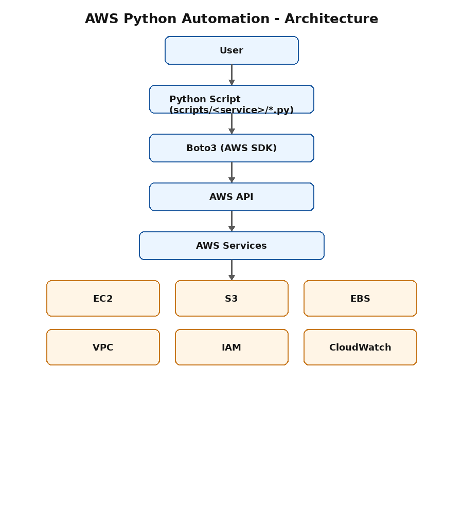

# AWS Python Automation (Boto3)

A complete, beginner-friendly toolkit for automating AWS infrastructure using **Python** and **Boto3**. Every script performs exactly one AWS task, so the project is easy to read, easy to learn from, and easy to reuse.



## Why This Project

Most AWS automation tutorials combine many operations into one script or one class. This project takes the opposite approach: **one script, one task**. This makes it ideal for:

- Learning how each individual Boto3 API call works
- Building a Cloud/DevOps/Python portfolio project
- Copying a single script into another project without dragging in the whole repo

## Features

- **46 standalone scripts** covering EC2, S3, EBS, VPC, Security Groups, IAM, and CloudWatch
- **One shared file** (`config.py`) for AWS clients and region configuration
- **Consistent structure** across every script: input → API call → success message → error handling
- **Friendly error messages** for common AWS errors (no raw tracebacks)
- **Optional interactive menu** (`menu.py`) that simply runs the standalone scripts
- **Full documentation** covering installation, AWS CLI setup, IAM setup, and cleanup

## Tech Stack

Python 3 · Boto3 · AWS CLI · IAM · EC2 · S3 · EBS · VPC · Security Groups · CloudWatch

## Project Structure

```text
aws-python-automation/
├── README.md
├── requirements.txt
├── .gitignore
├── config.py
├── menu.py
├── architecture.png
├── docs/
└── scripts/
    ├── ec2/              10 scripts
    ├── s3/                7 scripts
    ├── ebs/                8 scripts
    ├── vpc/               6 scripts
    ├── security_group/    5 scripts
    ├── iam/               6 scripts
    └── cloudwatch/        4 scripts
```

See `docs/project_structure.md` for a full breakdown.

## Quick Start

```bash
# 1. Clone the repository
git clone https://github.com/your-username/aws-python-automation.git
cd aws-python-automation

# 2. Create and activate a virtual environment
python3 -m venv venv
source venv/bin/activate   # Windows: venv\Scripts\activate

# 3. Install dependencies
pip install -r requirements.txt

# 4. Configure AWS credentials
aws configure

# 5. Run any script directly
python scripts/ec2/list_instances.py

# Or use the optional interactive menu
python menu.py
```

Full setup instructions are in `docs/installation.md`.

## Available Scripts

### EC2 (`scripts/ec2/`)
| Script | Description |
|---|---|
| `launch_instance.py` | Launch a new EC2 instance |
| `list_instances.py` | List all EC2 instances |
| `get_instance_status.py` | Get the status of one instance |
| `start_instance.py` | Start a stopped instance |
| `stop_instance.py` | Stop a running instance |
| `reboot_instance.py` | Reboot an instance |
| `terminate_instance.py` | Permanently terminate an instance |
| `create_key_pair.py` | Create a new EC2 key pair |
| `list_key_pairs.py` | List all key pairs |
| `delete_key_pair.py` | Delete a key pair |

### S3 (`scripts/s3/`)
| Script | Description |
|---|---|
| `create_bucket.py` | Create a new S3 bucket |
| `list_buckets.py` | List all S3 buckets |
| `upload_file.py` | Upload a local file to a bucket |
| `download_file.py` | Download a file from a bucket |
| `list_objects.py` | List objects inside a bucket |
| `delete_object.py` | Delete an object from a bucket |
| `delete_bucket.py` | Delete a bucket (must be empty) |

### EBS (`scripts/ebs/`)
| Script | Description |
|---|---|
| `create_volume.py` | Create a new EBS volume |
| `list_volumes.py` | List all EBS volumes |
| `attach_volume.py` | Attach a volume to an instance |
| `detach_volume.py` | Detach a volume from an instance |
| `delete_volume.py` | Delete a volume |
| `create_snapshot.py` | Create a snapshot of a volume |
| `list_snapshots.py` | List all snapshots |
| `delete_snapshot.py` | Delete a snapshot |

### VPC (`scripts/vpc/`)
| Script | Description |
|---|---|
| `create_vpc.py` | Create a new VPC |
| `list_vpcs.py` | List all VPCs |
| `create_subnet.py` | Create a subnet inside a VPC |
| `list_subnets.py` | List all subnets |
| `delete_subnet.py` | Delete a subnet |
| `delete_vpc.py` | Delete a VPC |

### Security Groups (`scripts/security_group/`)
| Script | Description |
|---|---|
| `create_security_group.py` | Create a new security group |
| `list_security_groups.py` | List all security groups |
| `authorize_ingress.py` | Add an inbound rule |
| `revoke_ingress.py` | Remove an inbound rule |
| `delete_security_group.py` | Delete a security group |

### IAM (`scripts/iam/`)
| Script | Description |
|---|---|
| `create_user.py` | Create a new IAM user |
| `list_users.py` | List all IAM users |
| `delete_user.py` | Delete an IAM user |
| `list_roles.py` | List all IAM roles |
| `create_access_key.py` | Create an access key for a user |
| `delete_access_key.py` | Delete an access key |

### CloudWatch (`scripts/cloudwatch/`)
| Script | Description |
|---|---|
| `list_metrics.py` | List available metrics |
| `list_alarms.py` | List all alarms |
| `create_alarm.py` | Create a new alarm |
| `delete_alarm.py` | Delete an alarm |

## How Each Script Is Built

Every script follows the same simple pattern:

1. A header comment explaining what the file does
2. Imports, including the shared AWS client from `config.py`
3. User input (if the operation needs it)
4. The AWS API call, wrapped in `try/except`
5. A clear, human-readable success message
6. Friendly error messages for common AWS errors — never a raw traceback

Example (`scripts/ec2/stop_instance.py`):

```python
from config import ec2_client
from botocore.exceptions import ClientError

def stop_instance():
    instance_id = input("Enter Instance ID to stop: ").strip()
    try:
        response = ec2_client.stop_instances(InstanceIds=[instance_id])
        print("Success! Stop request sent.")
    except ClientError as error:
        print(f"Error: {error.response['Error']['Message']}")

if __name__ == "__main__":
    stop_instance()
```

## config.py

`config.py` is the only file every script depends on. It creates the Boto3 clients once and stores the AWS region in a single place:

```python
REGION = "ap-south-1"

ec2_client = boto3.client("ec2", region_name=REGION)
s3_client = boto3.client("s3", region_name=REGION)
iam_client = boto3.client("iam", region_name=REGION)
cloudwatch_client = boto3.client("cloudwatch", region_name=REGION)
```

Change `REGION` to switch every script in the project to a different AWS region.

## menu.py (Optional)

`menu.py` is an optional interactive launcher. It only calls the standalone scripts using `subprocess` — it contains no AWS logic of its own. **The project works perfectly even if you delete `menu.py`.**

```bash
python menu.py
```

## Documentation

| Guide | Description |
|---|---|
| [docs/installation.md](docs/installation.md) | Full setup instructions |
| [docs/aws_cli_setup.md](docs/aws_cli_setup.md) | Installing and configuring the AWS CLI |
| [docs/iam_setup.md](docs/iam_setup.md) | Creating an IAM user with the right permissions |
| [docs/project_structure.md](docs/project_structure.md) | Detailed explanation of the project layout |
| [docs/cleanup_guide.md](docs/cleanup_guide.md) | How to clean up AWS resources to avoid charges |

## Screenshots

Screenshot placeholders live in `screenshots/<service>/`. Add your own screenshots of each script running, along with the matching result in the AWS Management Console.

## Cleaning Up

Running these scripts creates real AWS resources that can incur charges. See `docs/cleanup_guide.md` for the recommended order to delete everything you created during testing.

## Common Errors

| Error | Likely Cause |
|---|---|
| `Unable to locate credentials` | Run `aws configure` |
| `Access Denied` | Your IAM user is missing a required permission — see `docs/iam_setup.md` |
| `InvalidInstanceID.NotFound` | The Instance ID you entered doesn't exist in this region |
| `BucketAlreadyExists` | S3 bucket names must be globally unique — choose another name |
| `BucketNotEmpty` | Delete all objects in a bucket before deleting the bucket itself |

## Future Improvements

- Add unit tests using `moto` to mock AWS calls
- Add support for tagging resources on creation
- Add a `--region` command-line flag to override `config.py` per run
- Add Lambda and RDS automation scripts
- Add a Terraform version of the same infrastructure for comparison

## License

This project is provided as-is for educational and portfolio purposes.
# aws-automation-python
# aws-automation-python
